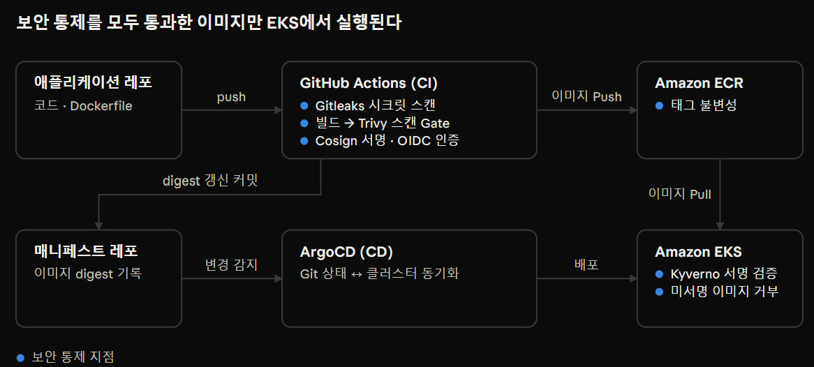
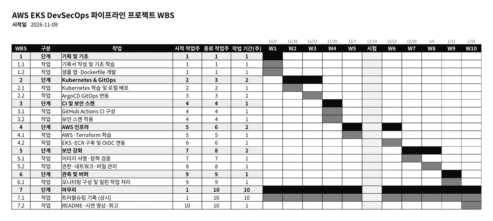

## 1) 프로젝트 개요
| 항목    | 내용                                                    |
| ----- | ----------------------------------------------------- |
| 프로젝트명 | GitHub Actions와 ArgoCD 기반 EKS DevSecOps 파이프라인 설계 및 구축 |
| 형태    | 개인 프로젝트                                               |
| 기간    | 26.11.09 ~ (약 10주간 진행)                                |
| 환경    | AWS - EKS, ECR, IAM / GitHub                          |
| 요약    | 공급망 공격을 직접 재현하고, 대응책을 적용해 차단하는 DevSecOps 파이프라인 구축     |

## 2) 배경 및 필요성
SolarWinds, Codecov 사고와 같이 CI/CD 파이프라인을 대상으로 한 공격들이 이루어지고 있고, 이로 인해서 빌드 · 배포 과정이 오염되면서 수많은 사용자가 피해를 입게 된다.
컨테이너 · 쿠버네티스 환경에서는 특히 다음 세 가지가 반복적으로 문제가 된다.
- CVE가 남아 있는 이미지가 검사 없이 배포
- CI에 넣어둔 장기 클라우드 자격증명 유출
- 레지스트리의 이미지가 바꿔치기 되어도 배포 단계에서 알아채지 못함

따라서 보안 검사를 배포 이후가 아닌 파이프라인 과정에 진행하는 DevSecOps 파이프라인을 구축하고, 이를 실제 환경에서 구현하고 검증하는 것을 목표로 한다.

## 3) 프로젝트 목표
GitOps 기반 배포 파이프라인을 구축하고, 위협 3가지가 대응책 적용 전에는 성공하고 적용 후에는 차단됨을 증명하는 것이 최종 목표이다.
1. 파이프라인 구축 : 코드 Push부터 EKS 배포까지 GitHub Actions · ECR · ArgoCD로 자동화
2. 위협 재현 : 취약 이미지 배포, 자격증명 노출, 이미지 변조를 실제로 성공시켜 피해 확인
3. 대응책 적용 : 이미지 스캔, 서명 · 검증, 최소 권한 임시 자격증명을 파이프라인에 통합
4. 차단 검증 : 같은 공격을 다시 수행해 차단됨을 로그 · 화면으로 출력

## 4) 시스템 아키텍처

## 5) 기술 스택

| 영역      | 도구                                                       |
| ------- | -------------------------------------------------------- |
| CI      | GitHub Actions                                           |
| CD      | ArgoCD                                                   |
| 인프라     | AWS EKS, ECR, IAM, Terraform                             |
| 이미지 스캔  | Trivy / Grype, ECR Enhanced Scanning                     |
| 시크릿 탐지  | Gitleaks / GitHub Secret Scanning                        |
| 서명 · 검증 | Cosign (Sigstore), Kyverno 또는 Sigstore Policy Controller |
| 인증      | GitHub OIDC -> IAM Role, IRSA / EKS Pod Identity         |

## 6) 추진 일정

## 7) 예상 결과물 및 기대 효과
### 결과물
- GitHub 저장소 (애플리케이션 배포, 매니페스트 레포, 워크플로, 정책 파일)
- 시나리오별 Before/After 검증 보고서 (로그 · 스크린샷)
- 프로젝트 계획서 · 최종 보고서 · README

### 기대 효과
- 빌드 단계에서 취약점을 막는 Shift-left 보안 체계 확보
- 장기 자격증명을 없애 유출 시 피해 범위 최소화
- 서명된 이미지만 재사용할 수 있는 파이프라인 템플릿
